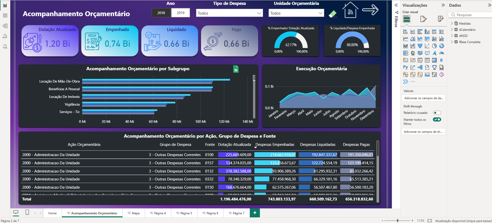
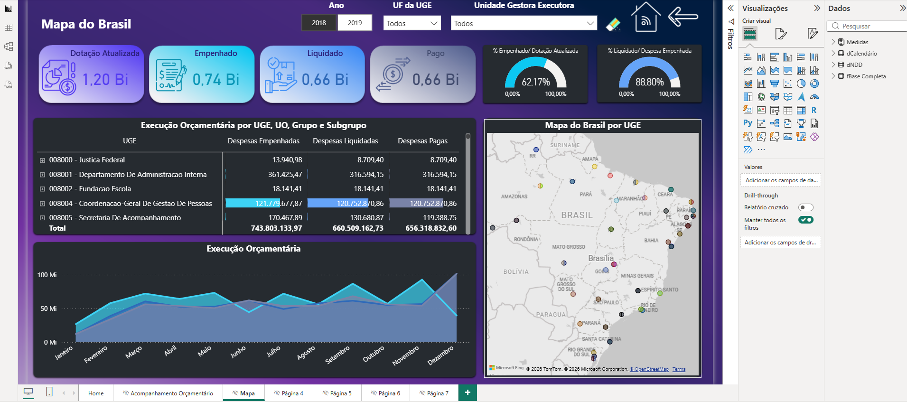

# Acompanhamento Orçamentário — Execução da Despesa (Power BI)

Painel em Power BI para acompanhar a execução do orçamento de um órgão público em dois exercícios (2018 e 2019): da dotação autorizada até a despesa empenhada, liquidada e paga, com visão por grupo de despesa, ação orçamentária, unidade e localização geográfica.

> Usando uma base de dados publica. O objetivo do painel foi: combinar fontes, tratar dados, modelar, criar medidas DAX (inclusive de inteligência de tempo) e construir um painel navegável.





## Perguntas que o painel responde

- Quanto do orçamento autorizado (dotação atualizada) já foi empenhado, liquidado e pago?
- Que percentual da dotação foi empenhado, e que percentual do empenhado foi liquidado?
- Quanto ainda falta empenhar, liquidar e pagar?
- Como a execução se compara com o mesmo período do ano anterior?
- Quais grupos, subgrupos e ações orçamentárias concentram mais despesa?
- Onde (UF e município) estão as unidades executoras que mais gastam?

## Conceitos de orçamento usados

| Etapa | Significado |
|---|---|
| **PLOA / LOA** | Proposta e lei orçamentária: o valor previsto para o ano |
| **Dotação atualizada** | Limite de gasto autorizado, já com ajustes durante o ano |
| **Empenho** | Reserva do valor para uma despesa (compromisso) |
| **Liquidação** | Confirmação de que o bem ou serviço foi entregue |
| **Pagamento** | Dinheiro efetivamente pago |

## Os dados

| Arquivo | Tipo | Conteúdo |
|---|---|---|
| `fBase 2018.xlsx` e `fBase 2019.xlsx` | Fato | 138.814 lançamentos diários (71.335 em 2018 e 67.479 em 2019), com PLOA, LOA, dotação, despesas empenhadas, liquidadas e pagas |
| `dNDD.xlsx` | Dimensão | 1.534 naturezas de despesa detalhadas, com categoria, grupo, subgrupo e grupo de despesa |
| `dCalendario.txt` | Dimensão | Tabela de datas de 2018 e 2019 |

A base cobre 5 unidades orçamentárias, 3 ações de governo, 78 unidades gestoras executoras em 27 UFs e 11 fontes de recurso.

## Modelagem

Modelo em estrela com a tabela fato `fBase Completa` no centro (união das bases de 2018 e 2019):

```
dCalendário ──┐
              ├──< fBase Completa
dNDD ─────────┘
```

- `fBase Completa[Dia Lançamento]` → `dCalendário[Data]` (muitos-para-um)
- `fBase Completa[Natureza Despesa Detalhada]` → `dNDD[NAT DESP]` (muitos-para-um)

## Tratamento no Power Query

**fBase Completa**
- União (append) das bases de 2018 e 2019 em uma única tabela
- Colunas de descrição padronizadas com `Text.Proper` (primeira letra maiúscula)
- Criação de colunas combinando código e descrição: **UO** (unidade orçamentária), **Ação Orçamentária**, **RP** (resultado primário) e **UGE** (unidade gestora executora)
- Remoção das colunas originais já combinadas
- Renomeação de colunas (Descrição NDD, CEP, UF, Município, PLOA, LOA, Dotação Atualizada etc.)
- Ajuste de tipos (datas, texto para CEP e natureza da despesa, números para os valores)

**dCalendário**
- Importação do arquivo de texto e conversão para data
- Colunas Ano, Mês e Nome do Mês (com a primeira letra maiúscula)

**dNDD**
- Importação da aba `NDD` e ajuste da chave `NAT DESP` para texto

## Medidas DAX

**Medidas base**
```DAX
PLOA = SUM('fBase Completa'[PLOA])
LOA = SUM('fBase Completa'[LOA])
Dotação Atualizada = SUM('fBase Completa'[Dotação Atualizada])
Despesas Empenhadas = SUM('fBase Completa'[Despesas Empenhadas])
Despesas Liquidadas = SUM('fBase Completa'[Despesas Liquidadas])
Despesas Pagas = SUM('fBase Completa'[Despesas Pagas])
```

**Indicadores de execução**
```DAX
% Despesa Empenhada/ Dotação Atualizada =
    DIVIDE([Despesas Empenhadas], [Dotação Atualizada])

% Despesa Liquidada/ Despesa Empenhada =
    DIVIDE([Despesas Liquidadas], [Despesas Empenhadas])

Despesas a Empenhar = [Dotação Atualizada] - [Despesas Empenhadas]
Empenhado a Liquidar = [Despesas Empenhadas] - [Despesas Liquidadas]
Liquidado a Pagar = [Despesas Liquidadas] - [Despesas Pagas]

Mais de 60% =
    IF([% Despesa Empenhada/ Dotação Atualizada] > 0.6, "Bom", "Ruim")
```

**Inteligência de tempo (comparação com períodos anteriores)**
```DAX
Empenhado ano anterior =
    CALCULATE([Despesas Empenhadas], SAMEPERIODLASTYEAR('dCalendário'[Data]))

Liquidado ano anterior =
    CALCULATE([Despesas Liquidadas], SAMEPERIODLASTYEAR('dCalendário'[Data]))

Pago ano anterior =
    CALCULATE([Despesas Pagas], SAMEPERIODLASTYEAR('dCalendário'[Data]))

Empenhado Mês anterior =
    CALCULATE([Despesas Empenhadas], PREVIOUSMONTH('dCalendário'[Data]))

Empenhado Mês anterior Dateadd =
    CALCULATE([Despesas Empenhadas], DATEADD('dCalendário'[Data], -1, MONTH))

Total empenhado acumulado =
    CALCULATE([Despesas Empenhadas], DATESYTD('dCalendário'[Data]))
```

**Contexto de filtro (CALCULATE, ALL, ALLSELECTED, FILTER)**
```DAX
TOTAL ALL = CALCULATE([Despesas Empenhadas], ALL('fBase Completa'))
TOTAL ALLSELECTED = CALCULATE([Despesas Empenhadas], ALLSELECTED('fBase Completa'))

Despesa Empenhada 2018 =
    CALCULATE([Despesas Empenhadas], 'dCalendário'[Ano] = "2018")

Empenhado 2018 Imobilizado =
    CALCULATE([Despesas Empenhadas],
        'dCalendário'[Ano] = "2018", dNDD[GRUPO] = "Imobilizado")

Empenhado > 20M =
    CALCULATE([Despesas Empenhadas],
        FILTER(VALUES(dNDD[GRUPO]), [Despesas Empenhadas] > 20000000))
```

## Páginas do painel

| Página | Conteúdo |
|---|---|
| **Home** | Capa com botão "Clique aqui para iniciar" |
| **Acompanhamento Orçamentário** | Cartões (dotação, empenhado, liquidado, pago), dois medidores (% empenhado/dotação e % liquidado/empenhado), barras por subgrupo, área por mês e tabelas por grupo e por ação orçamentária. Filtros por ano, resultado primário (RP) e unidade orçamentária (UO) |
| **Mapa** | Mesmos indicadores com mapa das unidades executoras, matriz por natureza de despesa, grupo, subgrupo e UGE. Filtros por ano, UF e UGE |
| **Páginas de dica (tooltip)** | Quatro páginas pequenas que aparecem ao passar o mouse: LOA e PLOA; a empenhar e empenhado no ano anterior; a liquidar e liquidado no ano anterior; a pagar e pago no ano anterior |

Também há plano de fundo personalizado, ícones, botões de navegação e botão para limpar filtros.

## Principais números

Calculados sobre toda a base (2018 e 2019), em reais:

| Indicador | 2018 | 2019 | Total |
|---|---|---|---|
| Dotação atualizada | R$ 1.196,5 mi | R$ 1.302,9 mi | R$ 2.499,4 mi |
| Despesas empenhadas | R$ 743,8 mi | R$ 819,2 mi | R$ 1.563,0 mi |
| % empenhado / dotação | 62,2% | 62,9% | 62,5% |
| % liquidado / empenhado | 88,8% | 85,9% | 87,3% |
| % pago / liquidado | 99,4% | 99,8% | 99,6% |

## Insights

- **Execução semelhante nos dois anos:** cerca de 62% da dotação foi empenhada em 2018 e em 2019. O painel classifica ambos como "Bom" pela regra de mais de 60%.
- **Gargalo na liquidação:** quase 100% do que é liquidado é pago, mas só 87% do empenhado chegou à liquidação, e a taxa caiu de 88,8% para 85,9% em 2019. Esse é o ponto de atenção da execução.
- **Concentração geográfica:** o Distrito Federal concentra cerca de 52% da despesa empenhada (R$ 809,4 mi), seguido de SP (R$ 172,4 mi), RJ (R$ 97,9 mi) e MG (R$ 91,4 mi).
- **Despesa empenhada cresceu cerca de 10%** de 2018 para 2019.

## Ferramentas

Power BI Desktop · Power Query (M) · DAX · Excel

## Como abrir

1. Baixe `Acompanhamento_Orcamentario.pbix` e a pasta `dados/`
2. Abra o `.pbix` no Power BI Desktop
3. Se pedir, atualize o caminho das fontes em **Transformar dados > Configurações da fonte de dados**, apontando para a pasta `dados/` no seu computador

## Autor

**Rayner Carvalho** — [LinkedIn](https://www.linkedin.com/in/raynercarvalho/)
